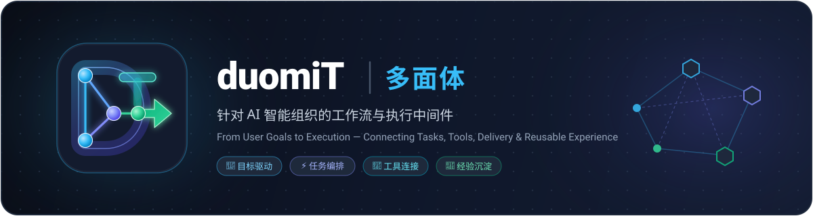

<div align="center">



# duomiT

### A local-first Builder for verifiable organizational work.

<p>
  <a href="./LICENSE"></a>
  <a href="#requirements"></a>
  <a href="#project-status"></a>
</p>

<p><a href="./README.md"><strong>English</strong></a> · <a href="./README.zh-CN.md">简体中文</a></p>
<p><a href="#quickstart">Quickstart</a> · <a href="#principles">Principles</a> · <a href="#capabilities">Capabilities</a> · <a href="#model-connectivity">Model Connectivity</a> · <a href="#project-status">Status</a></p>

</div>

---

**duomiT** is a local-first Builder for organizational work. It turns a member’s goal into inspectable, versioned planning objects while keeping identity, resource access, human approval, and future execution boundaries explicit.

LLMs are advisory API integrations—not authority holders. A model may return a candidate; duomiT validates the candidate, fixes the relevant versions, and never grants permissions or changes runtime state merely because a model suggested it.

## Quickstart

### Requirements

- Python 3.11 or later
- No runtime third-party dependency for the current reference implementation

```powershell
git clone https://github.com/LittleRockets/duomiT.git
cd duomiT
$env:PYTHONPATH = "src"
python -m duomit --model sequential
```

The command uses a deterministic offline reference model and does not require an API key.

## Principles

| Principle | What it means |
| --- | --- |
| **Local-first organization boundary** | Projects, tasks, sessions, artifacts, and configuration remain organization-scoped. An ID is never treated as authorization. |
| **Version before action** | Task revisions, flow drafts, descriptors, grants, context, and proposals are pinned or revisioned before downstream use. |
| **Human-verifiable planning** | Need, Workflow, Build, and Run are distinct planning domains. A process sketch is not an executable run. |
| **Least-privilege materials** | Artifact versions cross boundaries only through exact grants and validated ContextPackages. Revocation is rechecked on use. |
| **Pluggable, not ungoverned** | Public contracts describe compatible nodes and adapters; untrusted extensions do not become executable workflow nodes. |

## Capabilities

| Area | Available reference capability |
| --- | --- |
| **Foundation** | Versioned organization context, immutable references, redacted events, schema compatibility checks, and persisted configuration snapshots. |
| **Organization identity** | Persisted membership, device, and session bindings; expiry, suspension, and revocation block a session. |
| **Local workspace** | Organization-scoped local Project and Task entry path. |
| **Task planning input** | Immutable TaskRevision, deliverable and blocking-acceptance gates, and optimistic concurrency checks. |
| **Materials** | Immutable artifacts, exact-version ResourceGrant, revocation revalidation, and ContextPackage references. |
| **Flow intent** | Controlled FlowDraft templates, independent semantic/layout revisions, directed acyclic edges, and pinned ProcessIntent mapping. |
| **Node catalog and proposal review** | Immutable NodeDescriptor versions and review-only Proposal creation from pinned flow and descriptor inputs. |
| **Need, Workflow, Build, and Run** | Validated domain handoffs derive replayable process, delivery, readiness, and observability specifications; cross-task mixing is rejected and no executable work is created. |
| **Builder LLM boundary** | Provider API output is decoded only as a strict Need candidate and revalidated against TaskRevision; it cannot carry authority, tools, or state changes. |
| **Native Desktop shell** | A native local Project/Task shell that atomically creates and revises immutable task-planning versions (deliverable, blocking acceptance, constraints), reopens task-scoped controlled FlowDrafts, and previews pinned ProcessIntent; neither surface executes work, calls models, nor grants access. |

## Model Connectivity

Real LLMs are connected **only through APIs**; local model weights are not loaded. Planning and assistant roles are configured separately, so one role never silently falls back to the other.

| Service | Protocol | Default environment variable |
| --- | --- | --- |
| OpenAI / GPT | Responses | `OPENAI_API_KEY` |
| Google Gemini | generateContent | `GEMINI_API_KEY` |
| DeepSeek | Chat Completions | `DEEPSEEK_API_KEY` |
| xAI / Grok | Responses | `XAI_API_KEY` |

```powershell
# A planning model returns a schema-validated candidate.
python -m duomit --provider openai --model-id "<model-id>" --goal "Plan a data report"

# An assistant is a separate, text-only advisory role.
python -m duomit --assistant-provider gemini --assistant-model-id "<model-id>" --ask "Review the acceptance criteria"
```

`--api-key-env` and `--assistant-api-key-env` receive an environment-variable **name**, never a secret value.

## Native Desktop

The current reference shell is a native desktop process, not an HTTP service. It presents persisted Project/Task state without claiming that a draft is a running workflow.

## Project status

duomiT is in early development. The repository contains public contracts and deterministic reference adapters; it is **not** a production execution system.

- Existing reference paths do not yet compose a full production execution chain.
- OS-level isolation, distributed node authentication, collaborative sharing, arbitrary-code execution, high availability, and production identity-provider integration are not delivered.
- A FlowDraft, ProcessIntent, or review Proposal does not create WorkUnits, StepRuns, external operations, or model authority.

## Contributing

Issues and pull requests are welcome for public contracts, adapters, fixtures, and verification cases. Do not submit credentials, private organizational data, or proprietary strategy implementations.

## License

duomiT is released under the [Apache License 2.0](./LICENSE).

<p align="center"><br /><sub>duomiT · From goals to verifiable work</sub></p>
