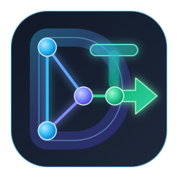

<div align="center">


<h3>把用户目标连接到可验证、可恢复的执行过程。</h3>

<p>
  <a href="#快速开始"></a>
  <a href="./LICENSE"></a>
  <a href="#当前状态"></a>
</p>

**[快速开始](#快速开始) · [模型接入](#模型接入) · [功能特性](#功能特性) · [开发验证](#开发验证)**

[问题反馈](https://github.com/LittleRockets/duomiT/issues) · [源码](https://github.com/LittleRockets/duomiT) · [许可证](./LICENSE)

</div>

---

**duomiT** 是面向智能组织的 AI 工作流与执行中间件。Builder 将目标转换为结构化计划，运行时管理执行、审批与恢复，让每次操作具有清楚的权限、状态和证据。

规划模型与助理模型独立配置，通过 API 接入 GPT、Gemini、DeepSeek、Grok。模型提供建议，系统校验计划；操作授权与执行状态由运行时管理。

<table>
<tr>
<td width="33%" valign="top"><h3>可验证的规划</h3>结构化计划、依赖校验与能力约束，让模型输出进入明确的执行契约。</td>
<td width="33%" valign="top"><h3>可恢复的执行</h3>持久化状态、人工审批与异常核对，保留操作上下文，避免盲目重试。</td>
<td width="33%" valign="top"><h3>受控的协作</h3>节点按授权连接交换消息，通过租约使用材料，保持运行和写入边界。</td>
</tr>
</table>

## 快速开始

需要 **Python 3.11+**，运行时无第三方依赖。以下为 PowerShell 示例：

```powershell
git clone https://github.com/LittleRockets/duomiT.git
cd duomiT
$env:PYTHONPATH = "src"
python -m duomit --model sequential
```

此命令使用固定的离线模板输出结构化计划，无需 API 密钥。

<details>
<summary><strong>安装到 Python 环境</strong></summary>

```powershell
python -m pip install .
python -m duomit --model sequential
```

当前从仓库源码安装，未提供 PyPI 安装入口。

</details>

## 模型接入

真实 LLM **统一通过 API 接入**，不加载本地模型权重。具体模型 ID 按账号权限和对应协议配置。

| 服务 | 协议 | 默认密钥环境变量 |
| :--- | :--- | :--- |
| **GPT / OpenAI** | Responses | `OPENAI_API_KEY` |
| **Gemini** | generateContent | `GEMINI_API_KEY` |
| **DeepSeek** | Chat Completions | `DEEPSEEK_API_KEY` |
| **Grok / xAI** | Responses | `XAI_API_KEY` |

### 规划与助理

在当前会话设置相应密钥环境变量后：

```powershell
# 规划模型：返回经过校验的结构化计划
python -m duomit --provider openai --model-id "<模型 ID>" --goal "生成数据报告计划"

# 助理模型：独立的文本建议入口
python -m duomit --assistant-provider gemini --assistant-model-id "<模型 ID>" --ask "检查这项需求的验收条件"
```

两个角色均支持四家服务，可以分别选择模型和密钥。未配置的角色不自动回退，会话和目标也不会隐式共享。`--api-key-env` 与 `--assistant-api-key-env` 接受环境变量**名称**，不接受密钥值。

<details>
<summary><strong>保存用户模型配置</strong></summary>

```powershell
python -m duomit --config-database settings.sqlite3 --save-config --assistant-provider gemini --assistant-model-id "<模型 ID>"
python -m duomit --config-database settings.sqlite3 --ask "梳理这项需求"
```

保存操作不请求模型，数据库仅记录模型选择与密钥引用。配置按用户和角色版本化，支持并发更新校验与停用控制。

</details>

<details>
<summary><strong>本地身份验证</strong></summary>

可信本地管理端可通过 `LocalIdentityStore.issue()` 签发有期限的访问令牌。设置 `DUOMIT_ACCESS_TOKEN` 后，命令行从令牌记录派生用户和租户身份：

```powershell
python -m duomit --identity-database identities.sqlite3 --config-database settings.sqlite3 --ask "梳理这项需求"
```

此示例要求该用户已保存助理模型配置。身份数据库仅保存令牌摘要，支持过期与撤销。未指定身份数据库时，命令行使用固定演示身份。

</details>

协议参考：[OpenAI](https://developers.openai.com/api/reference/resources/responses/methods/create) · [Gemini](https://ai.google.dev/api/generate-content) · [DeepSeek](https://api-docs.deepseek.com/api/create-chat-completion/) · [xAI](https://docs.x.ai/developers/rest-api-reference/inference/responses)。

## 功能特性

| 组件能力 | 已实现 |
| :--- | :--- |
| **计划契约** | JSON Schema、依赖和循环检测、能力范围校验、强制审批保留 |
| **模型与助理** | 四家 API 适配、独立角色绑定、显式会话历史、用量返回 |
| **运行时** | SQLite 持久化、幂等创建、模型与能力版本记录、取消、异常核对 |
| **审批与身份** | 操作摘要和版本绑定、审批有效期、本地访问令牌、用户归属校验 |
| **拓展材料** | 不可变版本、摘要校验、镜像租约、续期、释放、过期回收、版本撤回 |
| **节点参考环境** | 版本注册、受控子图、双向消息、消息预算、独立内存工作区、排空 |
| **执行证据** | 状态与事件事务写入、事件重放、组织隔离的投递确认、生命周期记录 |
| **基础契约** | 组织请求上下文、不可变版本引用、脱敏事件、Schema 兼容性检查与持久化配置快照 |
| **组织身份契约** | 成员、设备与会话持久化绑定；过期、暂停与撤销会阻断会话 |
| **本机工作区** | Project 与 Task 的本地持久化、组织归属校验与命令行录入参考路径 |
| **任务材料** | 本机不可变 Artifact、精确版本 ResourceGrant、撤权复核与 ContextPackage 引用边界 |

## 当前状态

项目处于早期开发阶段，当前版本用于验证接口、运行机制和交互边界。

- API 适配已通过模拟协议测试，尚未完成真实账号联调。仅支持官方 HTTPS 端点和非流式文本。
- 请求不自动重试、不自动切换服务商，也不自动使用系统代理；socket 超时尚不等于覆盖 DNS 的整体截止时间。
- 节点使用单线程进程内队列和内存工作区；材料使用不可变字节缓存，尚无文件系统挂载、操作系统级隔离或分布式节点认证。
- 工作流、节点和模型租约链仍有独立参考路径，尚未构成完整的生产执行链路。
- 中断恢复与核对由可信操作方处理；当前未提供生产认证服务、分布式故障转移或任意代码运行环境。

## 开发验证

```powershell
$env:PYTHONPATH = "src"
python -m unittest discover -s tests -v
python -m duomit --help
```

测试覆盖契约、身份、API 映射、审批、恢复、并发租约、节点访问边界及打包资源。模型协议测试不依赖真实密钥。

欢迎通过 [Issues](https://github.com/LittleRockets/duomiT/issues) 提交复现步骤、预期行为与实际结果，通过 Pull Request 贡献接口、适配器和验证案例。

## 许可证

本项目采用 [Apache License 2.0](./LICENSE)。

<p align="center"><br/><sub>duomiT · 从目标到执行</sub></p>
