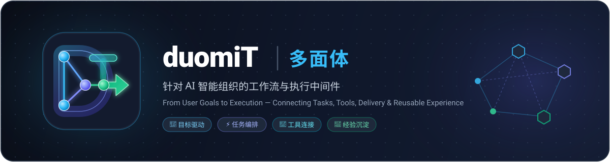
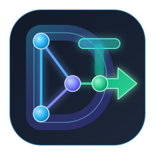

<div align="center">



# duomiT

### 面向智能组织的、本机优先的可验证 Builder。

<p>
  <a href="./LICENSE"></a>
  <a href="#运行要求"></a>
  <a href="#项目状态"></a>
</p>

<p><a href="./README.md">English</a> · <a href="./README.zh-CN.md"><strong>简体中文</strong></a></p>
<p><a href="#快速开始">快速开始</a> · <a href="#核心原则">核心原则</a> · <a href="#当前能力">当前能力</a> · <a href="#模型连接">模型连接</a> · <a href="#项目状态">项目状态</a></p>

</div>

---

**duomiT** 是面向组织工作的本机优先 Builder。它把成员目标转化为可审阅、可版本化的规划对象，并将身份、资源访问、人工确认与未来执行的边界保持明确。

LLM 是建议型 API 集成，不拥有权限。模型可以返回候选内容；duomiT 负责校验、固定相关版本，并且不会仅因模型建议就授予权限或改变运行状态。

## 快速开始

### 运行要求

- Python 3.11 或更高版本
- 当前参考实现没有运行时第三方依赖

```powershell
git clone https://github.com/LittleRockets/duomiT.git
cd duomiT
$env:PYTHONPATH = "src"
python -m duomit --model sequential
```

该命令使用确定性的离线参考模型，不需要 API 密钥。

## 核心原则

| 原则 | 含义 |
| --- | --- |
| **本机优先的组织边界** | Project、Task、会话、Artifact 与配置均处于组织范围内；对象 ID 从不被视为权限。 |
| **先固定版本，再进行动作** | TaskRevision、流程草稿、描述符、授权、上下文与提案在下游使用前均会固定版本或修订。 |
| **可人工核验的规划** | Need、Workflow、Build、Run 是独立规划能力域；流程草图不是可执行 Run。 |
| **最小权限材料流动** | ArtifactVersion 只能通过精确授权和校验后的 ContextPackage 跨越边界；使用时再次核验撤权。 |
| **可插拔而非无治理** | 公开契约定义兼容节点与适配器；不可信扩展不会直接成为可执行工作流节点。 |

## 当前能力

| 范围 | 已提供的参考能力 |
| --- | --- |
| **基础契约** | 版本化组织上下文、不可变引用、脱敏事件、Schema 兼容性检查与持久化配置快照。 |
| **组织身份** | 成员、设备、会话持久化绑定；过期、暂停与撤销会阻断会话。 |
| **本机工作区** | 组织范围内的本机 Project/Task 录入路径。 |
| **任务规划输入** | 不可变 TaskRevision、交付物与 blocking 验收门槛、乐观并发校验。 |
| **任务材料** | 不可变 Artifact、精确版本 ResourceGrant、撤权复核与 ContextPackage 引用。 |
| **流程意图** | 受控内置 FlowDraft 模板、独立语义/布局修订、有向无环边与固定摘要 ProcessIntent 映射。 |
| **节点目录与提案审阅** | 不可变 NodeDescriptor 版本，以及由固定流程和节点输入生成的只读审阅 Proposal。 |
| **Need、Workflow、Build 与 Run** | 经校验的领域交接可推导可重放的过程、交付、就绪与可观测性规格；跨任务混搭会被拒绝，且不会创建可执行工作。 |
| **Builder LLM 边界** | Provider API 输出只能解码为严格的 Need 候选，并按 TaskRevision 再校验；它不能携带权限、工具或状态变更。 |
| **原生 Desktop 壳层** | 原生、可访问的本机 Project/Task 工作台采用共享组件系统，提供可行动的空状态、保留选择的刷新与明确的本机保存反馈；它会原子化创建和修订不可变任务规划版本、重新打开任务范围内的受控 FlowDraft，并提供固定 ProcessIntent 预览；界面不会执行工作、调用模型或授予权限。 |

## 模型连接

真实 LLM **仅通过 API 接入**，不会加载本地模型权重。规划与助理角色分开配置，任一角色不会悄悄回退到另一角色。

| 服务 | 协议 | 默认环境变量 |
| --- | --- | --- |
| OpenAI / GPT | Responses | `OPENAI_API_KEY` |
| Google Gemini | generateContent | `GEMINI_API_KEY` |
| DeepSeek | Chat Completions | `DEEPSEEK_API_KEY` |
| xAI / Grok | Responses | `XAI_API_KEY` |

```powershell
# 规划模型返回经过 Schema 校验的候选。
python -m duomit --provider openai --model-id "<model-id>" --goal "规划一份数据报告"

# 助理是独立的、仅文本的建议角色。
python -m duomit --assistant-provider gemini --assistant-model-id "<model-id>" --ask "审阅验收条件"
```

`--api-key-env` 与 `--assistant-api-key-env` 接收的是环境变量**名称**，不是密钥值。

## 原生 Desktop

当前参考壳层是原生桌面进程，不是 HTTP 服务。它展示持久化的 Project/Task 状态，不会把草稿伪装为正在运行的工作流。

## 项目状态

duomiT 处于早期开发阶段。此仓库提供公开契约和确定性参考适配器，**不是**生产执行系统。

- 现有参考路径尚未组成完整的生产执行链。
- 操作系统级隔离、分布式节点认证、协作共享、任意代码执行、高可用和生产身份提供方集成均尚未交付。
- FlowDraft、ProcessIntent 或审阅 Proposal 均不会创建 WorkUnit、StepRun、外部操作或模型权限。

## 参与贡献

欢迎为公开契约、适配器、测试夹具与验证案例提交 Issue 和 Pull Request。请不要提交凭据、组织私有数据或专有策略实现。

## 许可证

duomiT 采用 [Apache License 2.0](./LICENSE)。

<p align="center"><br /><sub>duomiT · 从目标到可验证的工作</sub></p>
